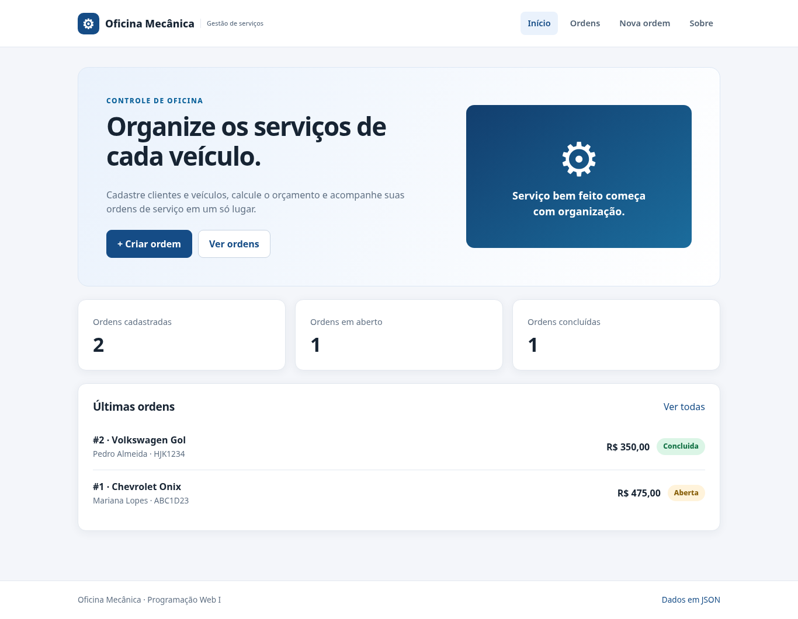
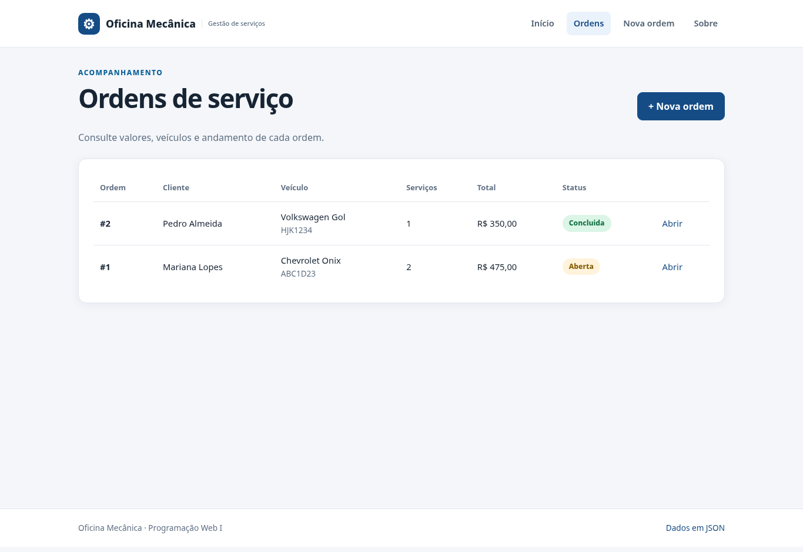
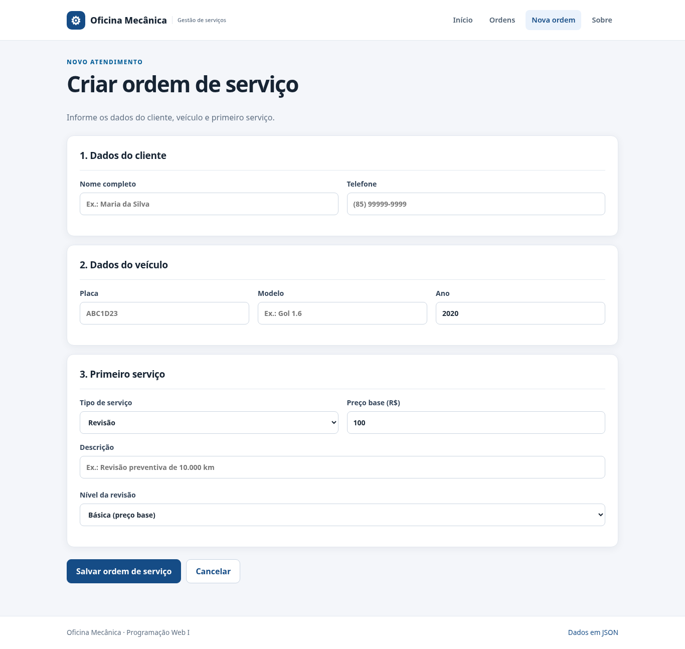
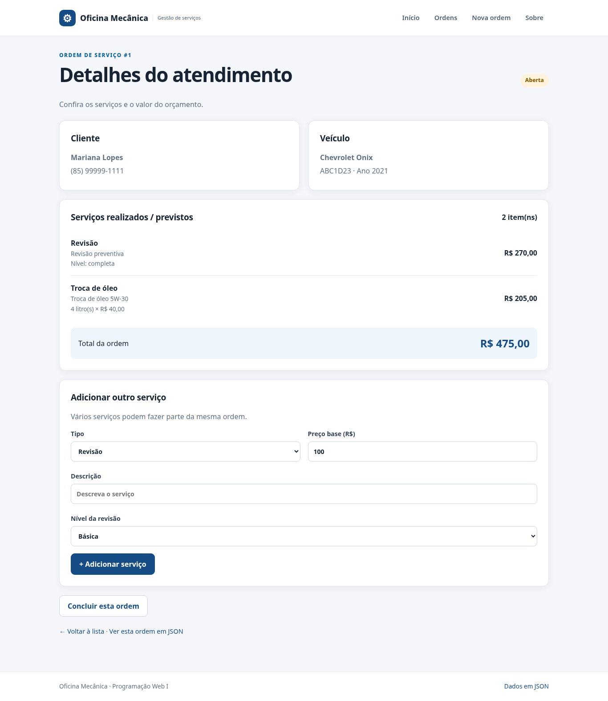

# Oficina Mecânica — Sistema Web Orientado a Objetos em PHP

Sistema web acadêmico para cadastrar clientes, veículos e ordens de serviço de uma oficina mecânica. Cada ordem possui um ou mais serviços (revisão, troca de óleo e funilaria), cujo preço é calculado conforme a modalidade. Os dados são persistidos em um arquivo JSON.

## Como executar

**Requisito:** PHP 8.1 ou superior.

```bash
# Dentro da pasta pweb1-trabalho-oo
php -v
php teste.php
php -S localhost:8000 -t public -d display_errors=1 -d output_buffering=0
```

Abra **http://localhost:8000**. 

```bash
php popular.php
```
## Telas



| Ordens de serviço | Formulário de nova ordem | Detalhes e adição de serviços |
|---|---|---|
|  |  |  |

## Funcionalidades

- Cadastrar uma **ordem de serviço**, informando cliente, telefone, veículo e primeiro serviço.
- Consultar ordens, quantidade de serviços, valores calculados e status.
- Adicionar vários serviços à mesma ordem enquanto estiver aberta.
- Concluir a ordem; uma ordem concluída **não** aceita novos serviços.
- Ver os dados em JSON pelo navegador ou `curl`.
- Manter os registros em `data/ordens.json` após recarregar a página e reiniciar o servidor (bônus).

## Rotas

| Método | Endereço | Resultado |
|---|---|---|
| GET | `/?pagina=inicio` ou `/` | Painel inicial |
| GET | `/?pagina=ordens` | Lista de ordens |
| GET | `/?pagina=nova` | Formulário de criação |
| POST | `/?pagina=nova` | Salva a ordem, ou exibe mensagem de erro |
| GET | `/?pagina=detalhes&id=1` | Detalhes da ordem 1 |
| POST | `/?pagina=detalhes&id=1` | Adiciona serviço ou conclui a ordem |
| GET | `/?pagina=sobre` | Explicação do sistema |
| GET | `/?formato=json` | JSON com todas as ordens |
| GET | `/?formato=json&id=1` | JSON da ordem 1 |
| GET | `/?pagina=qualquer-coisa` | HTTP 404 |
| GET | `/?pagina=detalhes&id=999` | HTTP 404 se não existir |

A rota JSON permite somente `GET`; `POST` retorna HTTP 405 e `Allow: GET`.

### Exemplos de `curl`

```bash
curl -i 'http://localhost:8000/?formato=json'
curl -i 'http://localhost:8000/?pagina=nao-existe'
curl -i 'http://localhost:8000/?pagina=detalhes&id=999'

curl -i -X POST 'http://localhost:8000/?pagina=nova' \
  --data-urlencode 'acao=criar' \
  --data-urlencode 'nome=Ana Pereira' \
  --data-urlencode 'telefone=(85) 99999-1234' \
  --data-urlencode 'placa=ABC1D23' \
  --data-urlencode 'modelo=Fiat Uno' \
  --data-urlencode 'ano=2020' \
  --data-urlencode 'tipo_servico=troca_oleo' \
  --data-urlencode 'descricao=Troca de oleo' \
  --data-urlencode 'preco_base=40' \
  --data-urlencode 'litros=4' \
  --data-urlencode 'preco_litro=35'
```

Em uma ordem com preço base de R$ 40,00, 4 litros e R$ 35,00 por litro, o cálculo é **40 + (4 × 35) = R$ 180,00**.

## Regras de negócio

1. O cliente deve ter nome de 3 a 100 caracteres e telefone com formato permitido.
2. A placa deve estar no formato brasileiro `ABC1234` ou `ABC1D23`; o ano deve ser válido.
3. Serviço não aceita descrição vazia nem preço base negativo.
4. Revisão só pode ser **básica** ou **completa** (a completa custa 50% a mais).
5. Troca de óleo exige **mais de zero e no máximo 15 litros**, e preço por litro positivo.
6. Funilaria exige **1 a 200 horas** e valor positivo por hora.
7. A ordem **não pode ser concluída sem serviços** ou concluída duas vezes.
8. Uma ordem concluída **não recebe novos serviços**.

Todas essas recusas usam `throw new Exception(...)` e são tratadas por `try/catch` no formulário e nos testes.

## Estrutura do projeto

```text
pweb1-trabalho-oo/
├── README.md
├── src/
│   ├── carregar.php
│   ├── Servico.php            # classe-mãe abstrata
│   ├── Revisao.php            # classe filha
│   ├── TrocaOleo.php          # classe filha
│   ├── Funilaria.php          # classe filha
│   ├── Cliente.php
│   ├── Veiculo.php
│   ├── OrdemServico.php       # composição e polimorfismo
│   └── RepositorioOrdens.php  # arquivo JSON
├── public/
│   ├── index.php             # HTML, POST, rotas e JSON
│   └── estilo.css
├── data/
│   └── ordens.json           # persistência; fora da raiz pública
├── docs/
│   ├── modelagem.md          # diagrama Mermaid e justificativas
│   ├── testes.md             # testes e saídas reais
│   ├── llm.md                # registro e espaços para completar
│   ├── relatorio.pdf         # relatório técnico preliminar
│   └── roteiro-video.md      # roteiro sugerido para gravação
├── popular.php               # dados fictícios opcionais
└── teste.php                 # testes por linha de comando
```

## Requisitos do enunciado: onde encontrar

| Requisito | Arquivo / implementação |
|---|---|
| OO1 | 8 classes em `src/`; construtores, atributos tipados, `strict_types=1` |
| OO2 | `Servico` → `Revisao`, `TrocaOleo`, `Funilaria`; `extends`, `parent::__construct`, sobrescrita |
| OO3 | `OrdemServico::calcularTotal()`, `foreach` polimórfico |
| OO4 | Atributos `private` e getters, sem atributos públicos |
| OO5 | `throw new Exception` nos construtores e métodos; `try/catch` em `public/index.php` e `teste.php` |
| OO6 | `OrdemServico::$servicos`, `adicionarServico()` e `calcularTotal()` |
| OO7 | `paraArray()` nas classes serializadas, inclusive as filhas |
| OO8 | Uma classe por arquivo em `src/`; `require_once` em `src/carregar.php` |
| W1 | `?pagina=...`, menu/cabeçalho compartilhados, erro HTTP 404 |
| W2 | `?formato=json`, `Content-Type` JSON, `json_encode` e `paraArray()` |
| W3 | Formulário `method="POST"`, cria objetos e mostra mensagem de exceção |
| W4 | Função `h()` aplica `htmlspecialchars` aos dados exibidos |
| W5 | Tratamento das requisições no topo de `public/index.php`, antes do HTML |
| Bônus | `RepositorioOrdens`, `json_decode` e `file_put_contents(..., LOCK_EX)` |

**Observação:** `Servico` é abstrata para evitar um serviço genérico sem regra de cálculo. Interfaces não foram usadas porque as três subclasses já compartilham um contrato simples por herança.

## Documentação, relatório e testes

- [Diagrama e decisões de modelagem](docs/modelagem.md)
- [Saídas de testes reais e comandos HTTP](docs/testes.md)
- [Diário de LLM (preencher com suas interações verdadeiras)](docs/llm.md)
- [Relatório técnico em PDF](docs/relatorio.pdf)
- [Roteiro para vídeo](docs/roteiro-video.md)

## Passos de GitHub que precisam acontecer na sua conta

O enunciado pede repositório **público** chamado `pweb1-trabalho-oo`, com *issues*, branches por funcionalidade, *pull requests*, commits Conventional Commits e tags `v0.1-modelagem`, `v0.2-nucleo` e `v1.0-entrega`. **Esses eventos não podem ser comprovados só com os arquivos deste ZIP**, pois precisam ser feitos de verdade na sua conta do GitHub. Não atribua datas antigas a atividades novas.

Exemplo de fluxo a repetir de maneira real para suas alterações:

```bash
git init
git add .
git commit -m "chore: inicia o projeto de oficina mecanica"
git branch -M main
# Configure o seu remote; depois crie issues e branches reais no GitHub.
git checkout -b docs/revisao-modelagem
# Edite docs/modelagem.md, faça commit e abra um PR no GitHub.
git add docs/modelagem.md
git commit -m "docs: revisa modelagem da oficina"
```