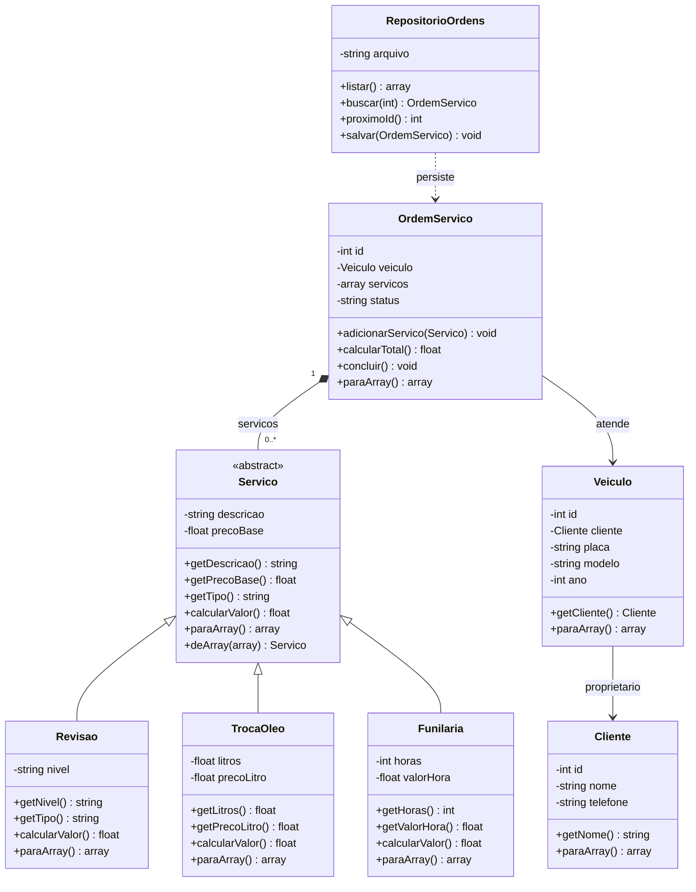

# Modelagem do sistema de Oficina Mecânica

## Diagrama de classes (Mermaid)

## Justificativas

### Herança

`Servico` é uma classe-mãe **abstrata**, pois todo serviço tem descrição e preço base, mas a forma de calcular o valor depende do tipo. Suas filhas `Revisao`, `TrocaOleo` e `Funilaria` reutilizam o construtor comum com `parent::__construct(...)` e sobrescrevem `calcularValor()`:

- **Revisao:** o preço base fica igual na revisão básica ou aumenta em 50% na completa.
- **TrocaOleo:** o valor é `precoBase + (litros × precoLitro)`.
- **Funilaria:** o valor é `precoBase + (horas × valorHora)`.

A herança evita repetir a validação da descrição e do preço base em três classes. A abstração impede instanciar um serviço genérico sem regra específica.

### Polimorfismo

Dentro de `OrdemServico::calcularTotal()`, o `foreach` percorre um `array` de objetos do tipo `Servico`. A chamada é sempre `$servico->calcularValor()`, mas o PHP escolhe a implementação da classe real de cada objeto. Assim, uma ordem com três serviços diferentes soma os três cálculos, sem precisar verificar seu tipo com `if` ou `switch`.

### Composição

`OrdemServico` **tem** vários serviços em seu atributo `private array $servicos`. O método `adicionarServico(Servico $servico)` inclui um objeto na lista e `calcularTotal()` calcula algo sobre os itens da lista. A ordem também está associada a um objeto `Veiculo`, que contém um objeto `Cliente`.

### Encapsulamento

Nenhuma classe de domínio declara atributos `public`. Todas usam propriedades `private`, getters para leitura e métodos de negócio para alteração controlada. Em vez de um setter público para o status, por exemplo, usa-se `concluir()`, que valida se há serviços e impede concluir duas vezes.

### Persistência

`RepositorioOrdens` salva a representação dos objetos com `paraArray()` e `json_encode()`. Para leitura, usa `json_decode()` e recria os objetos com `deArray()`, reexecutando as validações dos construtores. O arquivo `data/ordens.json` fica **fora da pasta `public/`**, não sendo servido diretamente pelo PHP embutido.

## Regras de negócio verificáveis

| Regra | Local | Mensagem de recusa |
|---|---|---|
| Nome de cliente inválido | `Cliente::__construct()` | `O nome do cliente deve ter entre 3 e 100 caracteres.` |
| Placa fora do padrão | `Veiculo::__construct()` | `A placa deve seguir o padrão brasileiro...` |
| Preço base negativo | `Servico::__construct()` | `O preço base não pode ser negativo.` |
| Litros fora do intervalo | `TrocaOleo::__construct()` | `A troca de óleo deve usar mais de 0 e no máximo 15 litros.` |
| Ordem sem serviços | `OrdemServico::concluir()` | `A ordem precisa ter pelo menos um serviço...` |
| Alterar ordem concluída | `OrdemServico::adicionarServico()` | `Não é possível adicionar serviços a uma ordem concluída.` |

## Limites desta versão

Este é um sistema acadêmico local, sem login, concorrência entre diversos usuários nem banco relacional. O controle de ID utiliza o maior número presente no JSON mais um. O arquivo é gravado com `LOCK_EX`, mas o ciclo de leitura e escrita não constitui uma transação multiusuário completa. Essas escolhas mantêm a implementação compatível com o escopo de Programação Web I.
